# Data Catalog & Architecture: Medallion Data Warehouse

A technical specification and metadata dictionary documenting the Medallion Data Warehouse architecture (Bronze, Silver, Gold).

---

## 1. Architectural Overview

```mermaid
flowchart LR
    subgraph Sources["Source Systems"]
        ERP["ERP System (Customers)"]
        CAT["Catalog (Products)"]
        POS["Point of Sale (Orders)"]
    end

    subgraph Bronze["Bronze Layer (Raw Staging)"]
        B_Cust["bronze.erp_customers_raw"]
        B_Prod["bronze.catalog_products_raw"]
        B_Ord["bronze.sales_orders_raw"]
    end

    subgraph Silver["Silver Layer (Conformed & Cleansed)"]
        S_Cust["silver.customers"]
        S_Prod["silver.products"]
        S_Ord["silver.orders"]
    end

    subgraph Gold["Gold Layer (Star Schema Data Mart)"]
        D_Cust["gold.dim_customers"]
        D_Prod["gold.dim_products"]
        D_Date["gold.dim_date"]
        F_Sales["gold.fact_sales (Columnstore)"]
    end

    Sources --> Bronze
    Bronze -->|Cleanse & Cast| Silver
    Silver -->|Model & Surrogate Keys| Gold
```

---

## 2. Medallion Layer Responsibilities

| Layer | Responsibility | Storage Strategy | Key Characteristics |
| :--- | :--- | :--- | :--- |
| **Bronze** | Raw data capture from transactional APIs & flat files. | Permissive `NVARCHAR` staging tables. | No transformations, audit timestamps (`ingested_at`), truncated per batch. |
| **Silver** | Cleaned, validated, and normalized relational entities. | Normalized rowstore tables with Primary Keys. | Type casting, string normalization, `NULL` standardization, deduplication. |
| **Gold** | Business-ready analytical reporting marts (Kimball Star Schema). | Conformed Dimensions + Fact tables with Clustered Columnstore. | Surrogate keys, pre-calculated business tiers, optimized for PowerBI / Tableau. |

---

## 3. Data Dictionary: Gold Layer (Star Schema)

### Dimension: `gold.dim_customers`
- **`customer_key` (INT, PK):** Synthetic surrogate key for dimensional joins.
- **`customer_id` (INT):** Natural key from ERP source system.
- **`customer_name` (NVARCHAR(100)):** Cleaned full name.
- **`customer_tier` (VARCHAR(20)):** Dynamically calculated loyalty bracket (`Platinum`, `Gold`, `Standard`).

### Dimension: `gold.dim_products`
- **`product_key` (INT, PK):** Synthetic surrogate key.
- **`sku_code` (VARCHAR(30)):** Standardized catalog SKU.
- **`category_name` (NVARCHAR(50)):** Conformed product classification.
- **`price_bracket` (VARCHAR(20)):** Price segment (`Premium`, `Mid-Range`, `Budget`).

### Fact: `gold.fact_sales`
- **`sales_key` (BIGINT, PK):** Surrogate grain identifier.
- **`customer_key` (INT, FK):** Links to `gold.dim_customers`.
- **`product_key` (INT, FK):** Links to `gold.dim_products`.
- **`order_date_key` (INT, FK):** Links to `gold.dim_date` (Format: `YYYYMMDD`).
- **`quantity_sold` (INT):** Additive measure.
- **`total_revenue` (DECIMAL(12,2)):** Additive revenue metric.
